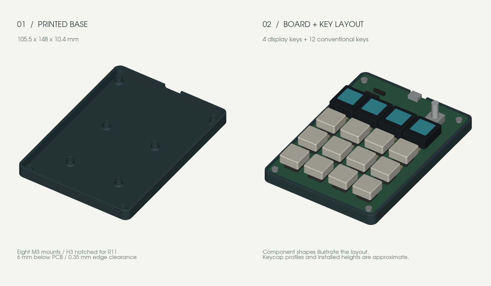

# keeb4x4 v2

A 4×4 macropad: STM32G431, 16 MX-style keys with per-key SK6812
RGB, up to 12 Waveshare 0.85" ScreenKey display keycaps, an EC11 rotary
encoder, and a USB-C connection that streams key/encoder events to the host
as JSON. Firmware is Rust/Embassy, with a resident USB bootloader so you never
need a debug probe after the first flash.



## What's here

| Path | Contents |
| --- | --- |
| `keeb4x4.kicad_{pro,sch,pcb}` | KiCad project: schematic and 4-layer PCB (100 × 142.5 mm) |
| [`fab/`](fab/README.md) | Gerbers, BOM and CPL for JLCPCB, plus order settings and hand-solder list |
| [`FIRMWARE_NOTES.md`](FIRMWARE_NOTES.md) | Pin map, matrix polarity, encoder, LED chain — the hardware facts firmware relies on |
| [`firmware/`](firmware/README.md) | Rust/Embassy application firmware |
| [`bootloader/`](bootloader/README.md) | USB DFU bootloader, recovery, memory layout |
| [`host/`](host/README.md) | `keeb` CLI: list devices, listen to events, build and flash firmware |
| [`enclosure/`](enclosure/README.md) | 3D-printable base (STL/STEP) and its parametric source |
| [`docs/PARTS.md`](docs/PARTS.md) | What to buy beyond the assembled board: ScreenKeys, switches, encoder |
| [`docs/PROGRAMMER.md`](docs/PROGRAMMER.md) | One-time bootloader flashing with an ST-Link clone |
| `tools/pcb/` | KiCad Python scripts used while routing the LED chain and GND stitching |

## Quick start (you have a board)

> **New board?**
> 1. Buy the parts that aren't on the assembled board: [docs/PARTS.md](docs/PARTS.md) (ScreenKeys, switches, encoder, ST-Link…)
> 2. Flash the pre-built firmware once with an ST-Link: [docs/PROGRAMMER.md](docs/PROGRAMMER.md). Image on the [releases page](https://github.com/TheRealBluesun/keeb4x4/releases/latest).

Requires [rustup](https://rustup.rs). Toolchains and targets are pinned per
project and install automatically.

```sh
cargo build --manifest-path host/Cargo.toml --release --locked
host/target/release/keeb list      # should show the board
host/target/release/keeb listen    # watch key / encoder events
```

To rebuild and flash firmware over USB:

```sh
host/target/release/keeb build
host/target/release/keeb update firmware/artifacts/update/keeb-v2.kbf
```

On Linux, install the udev rules first (see
[bootloader/README.md](bootloader/README.md#host-setup)). If the application
ever stops responding, hold the encoder button while plugging in USB to enter
recovery, then run `keeb update --recovery ...`.

**A newly assembled board is blank.** It needs a one-time bootloader install
over the SWD header (J3) with a cheap ST-Link V2 clone and `probe-rs`. Start
with **[docs/PROGRAMMER.md](docs/PROGRAMMER.md)**, which covers what to buy,
wiring and troubleshooting.

## Assembly notes

JLC assembles the SMT parts on both sides. You hand-solder the 16 switches,
the EC11 encoder, and the SWD/OLED headers. Check the
part rotations in JLC's preview before you order. See
[fab/README.md](fab/README.md).

The USB VID/PID (`c0de:cafe`, plus STM32 DFU `0483:df11` in recovery) are
prototype identities, not allocated ones.

## License

- Hardware (KiCad files, `fab/`, `enclosure/`): [CERN-OHL-P-2.0](LICENSE-HARDWARE)
- Software (`firmware/`, `bootloader/`, `host/`, `tools/`): [MIT](LICENSE-MIT)

ScreenKey init values are adapted from Waveshare's MIT-licensed example; see
[firmware/THIRD_PARTY.md](firmware/THIRD_PARTY.md).
