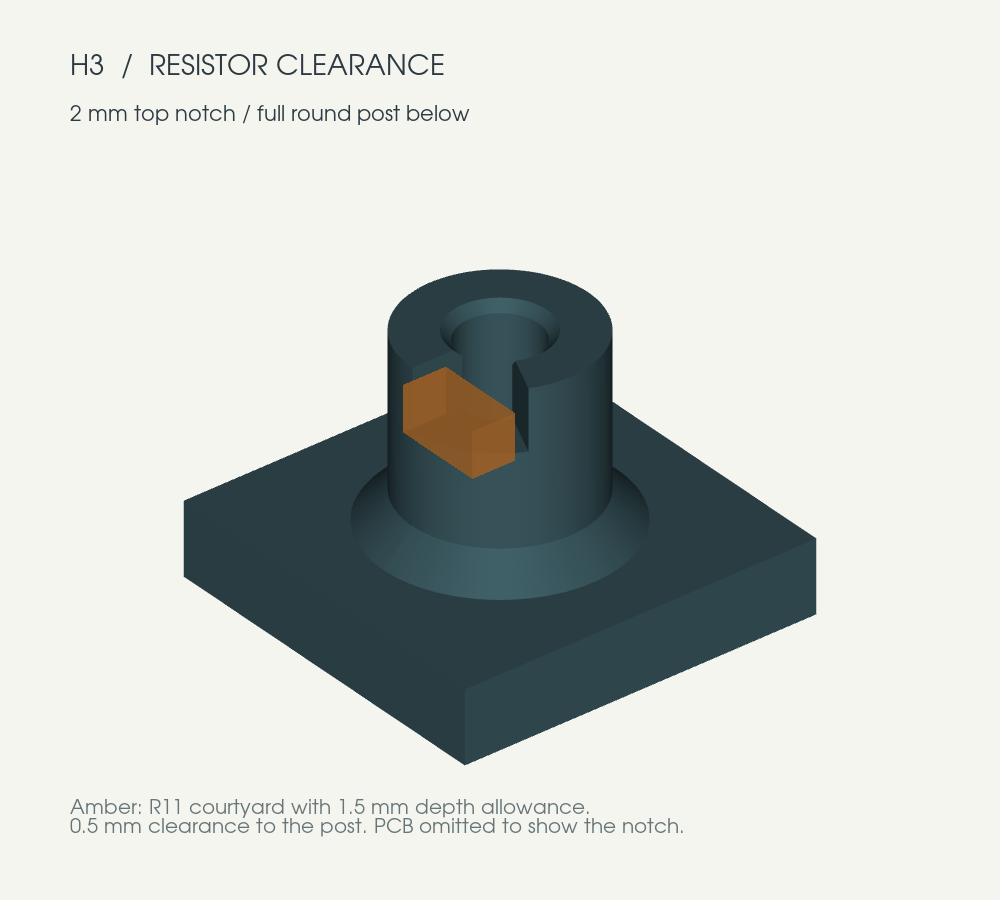

# keeb4x4 v2 printable base

A single-piece, open-top base for the **100 × 142.5 × 1.6 mm** PCB in
`../keeb4x4.kicad_pcb`. The board screws onto eight integral posts. A low rim
protects its edges, and an open notch accommodates the USB-C cable.

The first build uses **four Waveshare display keys on the top row and twelve
conventional keys below**. The base leaves the keys, ribbon cables, encoder,
OLED header, BOOT/RESET buttons and SWD header accessible.


## Print files

| File | Use |
| --- | --- |
| [keeb4x4_base.stl](exports/keeb4x4_base.stl) | Complete base, ready to slice in millimetres |
| [corner_fit_sample.stl](exports/corner_fit_sample.stl) | Optional 23 × 23 mm corner sample with the same wall, clearance and H7 screw post |
| [h3_fit_sample.stl](exports/h3_fit_sample.stl) | Optional 16 × 16 mm sample of the notched H3 post for checking R11 clearance |
| [keeb4x4_base.step](exports/keeb4x4_base.step) | Solid CAD model for editing/import into other CAD tools |
| [dimensions.pdf](exports/dimensions.pdf) | Dimensioned top-view drawing |
| [mechanical.json](exports/mechanical.json) | Extracted PCB geometry, source checksum and base parameters |
| [validation.json](exports/validation.json) | Geometry and mesh checks |

The **STL contains only the printable base**. The board, screws and components
shown in the preview illustrate placement; their installed heights, keycap
profiles and some component bodies are approximate. They are not included in
the print file. STEP is a solid interchange file; edit `base.py` for parameters.

## Dimensions and hardware

| Feature | Dimension |
| --- | --- |
| Outside size | **105.5 × 148 × 10.4 mm** |
| Wall / floor | 2.4 / 2.4 mm |
| PCB clearance at each edge | 0.35 mm |
| Space under PCB, measured from floor surface | 6.0 mm |
| PCB underside / top, above printed underside | 8.4 / 10.0 mm |
| Rim above PCB top | 0.4 mm |
| USB notch | 16 mm wide, open above Z = 6.5 mm, rounded lower corners |
| Mounting posts | 6 mm diameter, with reinforced feet |
| Blind screw pilots | 2.6 mm diameter × 7 mm deep, chamfered mouths |
| Fasteners | **8 × M3 × 8 mm pan/button-head screws**, no washers, nuts or inserts |

Screws form threads directly in the printed pilots. With the 1.6 mm PCB,
M3 × 8 screws enter the posts by 6.4 mm and stop 0.6 mm above the blind-hole
bottom. H3 has partial thread support in its upper 2 mm and a complete circular
wall below. Screw length is measured from under the head. Longer screws require
revisiting the pilot depth and remaining floor thickness.

**H3 has a local notch for R11.** The upper 2 mm of the post is cut away around
the resistor's bottom courtyard with 0.5 mm extra clearance. The pocket opens
into the screw bore, leaving a C-shaped top instead of a thin strip of plastic
between the screw and resistor. About **82% of the top bearing area remains**;
the lower **4 mm of the post stays fully circular**. The same M3 × 8 screw fits
all eight mounts. Bearing area and screw engagement have been checked
geometrically; strength has not been physically tested.

The notch allows R11 and its solder to extend **1.5 mm below the PCB**, leaving
0.5 mm beneath it. This is a design allowance, not a measured component height.
Use the H3 sample to check the actual assembly. Its notch points toward R11.
The other seven posts clear the bottom component courtyards and through-hole
pad envelopes by at least 1.20 mm at their full height.



Mount coordinates below use the **original KiCad coordinates**, viewed from
above, with the origin at the rear-left board corner, +X right and +Y toward
the front. CAD exports instead use the front-left origin and +Y toward USB:
`cad_y = 142.5 - kicad_y`.

| Mount | KiCad X | KiCad Y | Use |
| --- | ---: | ---: | --- |
| H1 | 5 | 8 | Screw |
| H2 | 95 | 8 | Screw |
| H3 | 27 | 59.5 | Screw; top notch clears R11 |
| H4 | 73 | 59.5 | Screw |
| H5 | 27 | 112.5 | Screw |
| H6 | 73 | 112.5 | Screw |
| H7 | 5.5 | 139 | Screw; corner sample location |
| H8 | 94.5 | 139 | Screw |

## Print and assemble

Starting settings for an FDM printer with a 0.4 mm nozzle:

- Print flat underside down, posts up, **100% scale, millimetres**.
- 0.2 mm layers, four walls, five top/bottom layers and 20–30% infill.
- PLA or PETG; supports are not needed for this geometry.
- Optional adhesive rubber feet go on the flat underside.

1. Print the corner sample first if the printer's fit tolerance is unknown.
   Test the front-left PCB corner/H7 and one M3 screw. The sample retains the
   full base height, edge clearance and blind pilot depth.
   The separate H3 sample lets you check the notched post against R11 before
   printing the full base; orient the notch toward the resistor.
2. Confirm that the populated board's underside, including solder tails,
   protrudes **less than 6 mm** below the PCB. Component heights are not encoded
   in the available PCB footprint data; this clearance has not been physically
   verified. Increase `UNDERSIDE_CLEARANCE` if needed.
   At H3, check that R11 including solder projects no more than **1.5 mm** to
   retain the notch's 0.5 mm vertical clearance. `POST_RELIEFS` controls this
   local allowance independently of the overall underside space.
3. Lower the PCB onto the posts with USB-C at the notch. It should sit flat
   without forcing it against the rim or onto an underside component.
4. Install eight M3 × 8 screws. Snug them gently; the threads
   are plastic. Install keycaps after the screws so the driver can reach them.
5. Check the actual USB cable jacket in the notch. The 16 mm opening is a
   generous starting fit, but cable mouldings vary.

The base supports the PCB. It does not add a switch plate or change the board's
existing switch mounting arrangement.

## Board and display-key references

`keeb-v2` was selected because it is newer than `test-4x4` and contains a
fabrication package, a BOM with LCSC part numbers, 100 SMT placements and
specific hand-assembled part selections. The production Gerber outline matches
the source PCB's 100 × 142.5 mm rounded rectangle. See [fabrication notes](../fab/README.md).
The older board is 77.2 × 109.2 mm and lacks these eight mounting holes.

The matching Waveshare product is the **0.85inch ScreenKey LCD W/B keycap**,
which uses the documented 12-pin LCD interface. Waveshare gives its cap body
as **22 × 25.3 × 8.6 mm**, and identifies a **9.2 mm non-bending ribbon section**.
Its separate switch/carrier-PCB module is a different assembly.

- [Waveshare product and mechanical dimensions](https://docs.waveshare.com/0.85inch-ScreenKey-Module-W)
- [Keycap dimension drawing](https://docs.waveshare.com/assets/images/0.85-size-1-acf62195bef53c091d9408969df93c56.webp)
- [Waveshare CAD/drawing resources](https://docs.waveshare.com/0.85inch-ScreenKey-Module-W/Resources-And-Documents)

The source PCB has **23 mm horizontal × 26.5 mm vertical pitch**. Its top row
has switch centres at X = 15.5, 38.5, 61.5, 84.5 and KiCad Y = 46.25 mm.
The 22 mm display caps therefore have 1 mm nominal horizontal spacing between
their body envelopes. Cap centre placement and ribbon routing must still be
checked on the assembled switches. The open base does not constrain either.
The conventional 18 × 18 mm caps in the preview are illustrative.

## Regenerate

The model uses [CadQuery](https://cadquery.readthedocs.io/en/stable/intro.html),
an editable Python parametric CAD workflow. From this directory:

```bash
uv venv --python 3.11 .venv
uv pip install --python .venv/bin/python -r requirements.txt
.venv/bin/python base.py
.venv/bin/python preview.py
```

On a Linux machine without a display, use
`xvfb-run -a .venv/bin/python preview.py` for the preview command.
Dependencies for this initial generation were installed in
`/tmp/agent-keyboard-cad`, outside the project.

Edit fit values at the top of `base.py`. Changing board thickness, post height
or pilot depth can require a different screw length; the generator checks that
the selected screw does not bottom out. The footprint reader takes switch
centres from their 4 mm centre-post drills, rather than the off-centre KiCad
footprint origins. It rejects a changed overall board outline pending review.

Generation checks solid validity, a single connected part, zero PCB collision,
post clearance to bottom courtyards/pads, open blind bores, support annuli,
R11's 3D clearance, H3's retained bearing area and intact lower screw wall, and
watertight, consistently oriented STL meshes. **No physical print or fit test
has been performed yet.**
